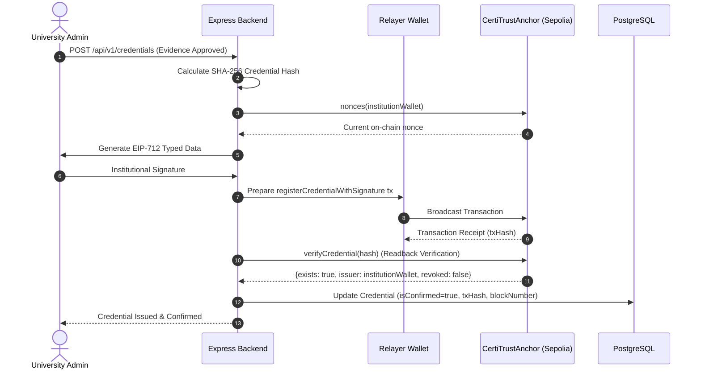

# Blockchain Technical Documentation: CertiTrustAnchor

> **Decentralized Skill Evidence and Credential Validation Platform**  
> Smart Contract Architecture, EIP-712 Relayed Execution, Cryptographic Anchoring, Verification, and Revocation.

---

## 1. Smart Contract Architecture

The primary smart contract governing the decentralized integrity of CertiTrust is **`CertiTrustAnchor`** (`contracts/CertiTrustAnchor.sol`), developed for Ethereum Sepolia (and EVM-compatible networks, Chain ID `11155111` or local Hardhat `31337`).

### 1.1 Core Principles
- **Minimalist On-Chain Footprint:** Only 32-byte cryptographic hashes (`bytes32 credentialHash`), issuer wallet addresses (`address issuer`), Unix timestamps (`uint256 issuedAt`), and status booleans (`revoked`, `exists`) are stored on-chain. Sensitive PII (student names, grades, evidence files) is never committed to the public ledger.
- **EIP-712 Signature Relay:** Institutions hold their own private keys. Rather than requiring universities to pay gas fees directly from their administrative accounts, CertiTrust uses EIP-712 typed structured data hashing. Institutions sign an off-chain message authorization, which a relayer wallet broadcasts on-chain.
- **Strict Cryptographic Attribution:** Even when gas is sponsored by a relayer, the contract enforces that `credentials[credentialHash].issuer == recoveredSigner`, guaranteeing non-repudiation.
- **Replay Protection:** Per-institution nonce mapping (`mapping(address => uint256) public nonces`) and unix deadline thresholds prevent transaction replay attacks and stale transaction execution.
- **Signature Malleability Safeguards:** Assembly parsing enforces low-$s$ values ($s \le \text{secp256k1n}/2$) and canonical $v \in \{27, 28\}$ to eliminate ECDSA signature malleability exploits.

---

## 2. Data Structures & State Variables

### 2.1 Credential Struct
```solidity
struct Credential {
    bytes32 credentialHash;  // SHA-256 / Keccak-256 digest of credential payload
    address issuer;          // Cryptographic wallet address of issuing institution
    uint256 issuedAt;        // Unix timestamp of block inclusion
    bool revoked;            // Revocation state flag
    bool exists;             // Existence sentinel flag
}
```

### 2.2 Storage Layout
- `address public owner`: The contract administrator who manages institutional onboarding.
- `mapping(bytes32 => Credential) public credentials`: Primary lookup mapping from credential hash to struct.
- `mapping(address => bool) public authorizedIssuers`: Whitelist mapping for accredited institutions.
- `mapping(address => uint256) public nonces`: Monotonically increasing sequence counters per issuer for replay protection.
- `bytes32 public immutable DOMAIN_SEPARATOR`: Cached EIP-712 domain hash binding the contract name (`CertiTrustAnchor`), version (`1`), chain ID (`block.chainid`), and contract address (`address(this)`).

---

## 3. Contract Functions & Specification

### 3.1 Administrative Functions
- `transferOwnership(address newOwner)`:
  - Access: `onlyOwner`
  - Reverts if `newOwner == address(0)`.
  - Emits `OwnershipTransferred(address previousOwner, address newOwner)`.
- `authorizeIssuer(address issuer)`:
  - Access: `onlyOwner`
  - Whitelists an institution address to issue credentials.
  - Emits `IssuerAuthorized(address indexed issuer)`.
- `deauthorizeIssuer(address issuer)`:
  - Access: `onlyOwner`
  - Revokes an institution's issuance privilege.
  - Emits `IssuerDeauthorized(address indexed issuer)`.

### 3.2 Credential Anchoring Functions
- `registerCredential(bytes32 credentialHash)`:
  - Access: `onlyAuthorizedIssuer` (Direct execution where issuer pays gas).
  - Validates `credentialHash != bytes32(0)` and `!credentials[credentialHash].exists`.
  - Records credential with `issuer = msg.sender`.
  - Emits `CredentialRegistered(bytes32 indexed credentialHash, address indexed issuer, uint256 timestamp)`.
- `registerCredentialWithSignature(bytes32 credentialHash, address issuer, uint256 nonce, uint256 deadline, bytes calldata signature)`:
  - Access: Public (Relayer execution).
  - Validates:
    1. `block.timestamp <= deadline`
    2. `authorizedIssuers[issuer] == true`
    3. `nonces[issuer] == nonce`
    4. Recovered EIP-712 signer equals `issuer`.
  - Increments `nonces[issuer]`.
  - Enforces low-$s$ ECDSA malleability limit.
  - Commits credential to storage and emits `CredentialRegistered`.

### 3.3 Credential Revocation Functions
- `revokeCredential(bytes32 credentialHash)`:
  - Access: `msg.sender == cred.issuer || msg.sender == owner`.
  - Reverts if credential does not exist or is already revoked.
  - Sets `cred.revoked = true`.
  - Emits `CredentialRevoked(bytes32 indexed credentialHash, address indexed issuer, uint256 timestamp)`.
- `revokeCredentialWithSignature(bytes32 credentialHash, address issuer, uint256 nonce, uint256 deadline, bytes calldata signature)`:
  - Access: Public (Relayed revocation).
  - Validates:
    1. `block.timestamp <= deadline`
    2. `credentials[credentialHash].exists == true`
    3. `credentials[credentialHash].issuer == issuer`
    4. `!credentials[credentialHash].revoked`
    5. `nonces[issuer] == nonce`
    6. EIP-712 recovered signer matches `issuer`.
  - Increments `nonces[issuer]`, updates `cred.revoked = true`, and emits `CredentialRevoked`.

### 3.4 Verification Functions
- `verifyCredential(bytes32 credentialHash) external view returns (bool exists, address issuer, uint256 issuedAt, bool revoked)`:
  - Pure view query providing instantaneous O(1) status lookup.
  - Returns complete tuple consumed by verifier applications and backend verification services.

---

## 4. EIP-712 Domain and Type Schemas

### 4.1 Domain Separator
```
EIP712Domain(string name,string version,uint256 chainId,address verifyingContract)
name: "CertiTrustAnchor"
version: "1"
```

### 4.2 Type Hashes
- **Issuance TypeHash:**
  ```solidity
  keccak256("IssueAuthorization(bytes32 credentialHash,address issuer,uint256 nonce,uint256 deadline)")
  ```
- **Revocation TypeHash:**
  ```solidity
  keccak256("RevokeAuthorization(bytes32 credentialHash,address issuer,uint256 nonce,uint256 deadline)")
  ```

---

## 5. Backend Transaction Lifecycle & Reconciliation

### 5.1 Real-Time Issuance Flow


### 5.2 Pending Anchor Reconciliation (`jobs.service.js`)
The background reconciliation worker executes every 60 seconds to resolve transient network drops and pending mempool transactions:
1. **Anchors with Existing Transaction Hash:**
   - Queries `provider.getTransactionReceipt(txHash)`.
   - If mined with `receipt.status === 1`:
     - Reads back on-chain data with `contract.verifyCredential(hash)`.
     - Validates on-chain issuer equals institution wallet address.
     - Sets `isConfirmed: true`, `blockNumber: receipt.blockNumber`.
   - If mined with `receipt.status === 0`:
     - Marks record as failed; increments retry counter.
2. **Anchors with `transactionHash: null` (Submitted but Unconfirmed):**
   - First reads back `contract.verifyCredential(hash)` to prevent duplicate gas consumption if already mined.
   - If confirmed on-chain: reconciles database record immediately.
   - If unconfirmed: re-signs via institutional key and broadcasts with updated network gas parameters.

---

## 6. Smart Contract Deployment & Verification

### 6.1 Local Hardhat Network
```bash
cd blockchain
npx hardhat node
npx hardhat run scripts/deploy.js --network localhost
```

### 6.2 Ethereum Sepolia Testnet
```bash
cd blockchain
npx hardhat run scripts/deploy.js --network sepolia
```

Deployment parameters are written to `backend/.env`:
- `BLOCKCHAIN_RPC_URL`: `https://rpc.sepolia.org` or Alchemy/Infura endpoint.
- `CONTRACT_ADDRESS`: Target contract address.
- `CHAIN_ID`: `11155111` (Sepolia) or `31337` (Localhost).
